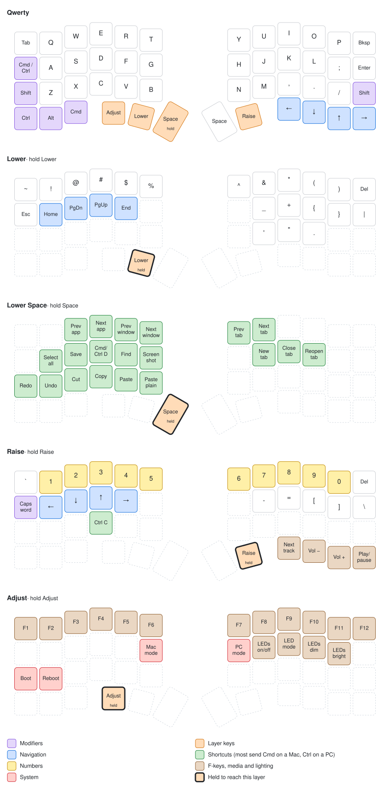

# natewlew's Cornison layout

My daily-driver keymap: 5 layers (Qwerty, Lower, Lower+Space, Raise,
Adjust) with OS-aware shortcuts that send Cmd on a Mac and Ctrl on a PC.

Blank dashed keys fall through to the layer below. The outlined key on
each layer is the one you hold to get there.

## How it works

* **Mac or PC mode follows the computer.** QMK's OS detection sets it
  each time the keyboard is plugged in: on a Mac the shortcut keys send
  Cmd; on Linux/Windows they send Ctrl, and Alt and Cmd swap places for a
  PC layout. `Mac mode` / `PC mode` on the Adjust layer (`AG_NORM` /
  `AG_SWAP`) set it by hand until the next detection.
* **KVM:** `config.h` sets `OS_DETECTION_KEYBOARD_RESET`, so the keyboard
  restarts and re-detects when a KVM (e.g. one built into a monitor)
  switches it to another computer without cutting its power. If it ever
  comes up in the wrong mode, `Reboot` on the Adjust layer (`QK_RBT`)
  restarts it and it detects again. If the restart misbehaves, delete the
  define and use the Adjust layer's mode keys.
* **Lower+Space:** the left half's big thumb key is Space when tapped and
  the shortcut layer when held. `Next app` / `Prev app` keep Cmd (Alt on a
  PC) down until you let go of it, so you can step through the switcher.
  The right half has browser tabs: `Next tab` / `Prev tab` (Ctrl+Tab on
  both systems), and new, close and reopen tab.
* **Caps word** (Raise): caps for the next word only, e.g. `MAX_SIZE`; it
  turns itself off at a space.
* **OLED** (on the half with the USB cable): the layer, Mac or PC mode
  with the OS it detected, and `CAPS WORD` / `CAPS LOCK` when on.
* `natewlew.c`/`natewlew.h` started as a copy of `users/natewlew` from my
  `qmk_userspace` and have since moved on, so this keymap builds from this
  repo alone. `rules.mk` keeps QMK from also pulling in the userspace copy.

## Build and flash

    qmk compile -kb cornison -km natewlew

Flash each half (this also writes its handedness, see [the keyboard's
readme](../../readme.md)):

    qmk flash -kb cornison -km natewlew -bl avrdude-split-left   # left half
    qmk flash -kb cornison -km natewlew -bl avrdude-split-right  # right half

## Redrawing the picture

`keymap.svg` is drawn from `keymap.c` and the board's real key positions.
After changing the keymap, from the repo root:

    ./build.sh keymap-svg

A new custom keycode shows up uncoloured under its own name until it's
added to `LABELS` in `firmware/qmk/draw_keymap.py`.
